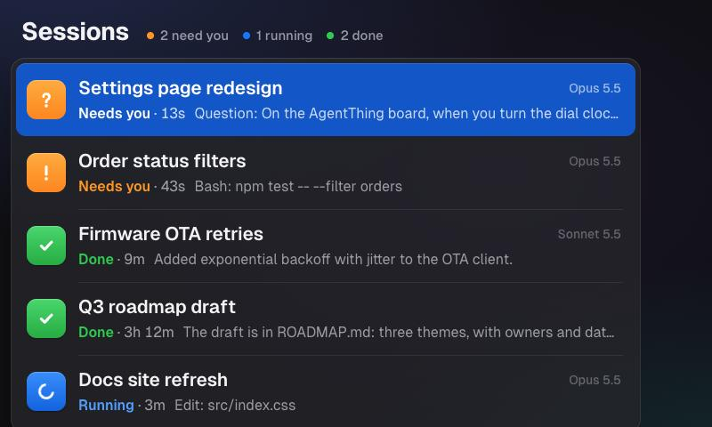
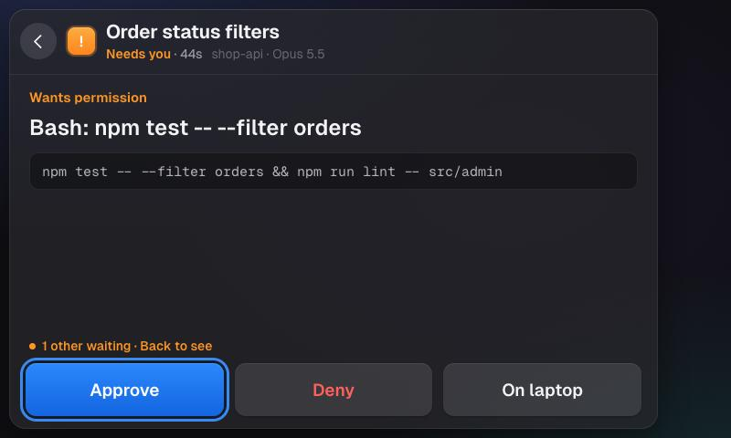
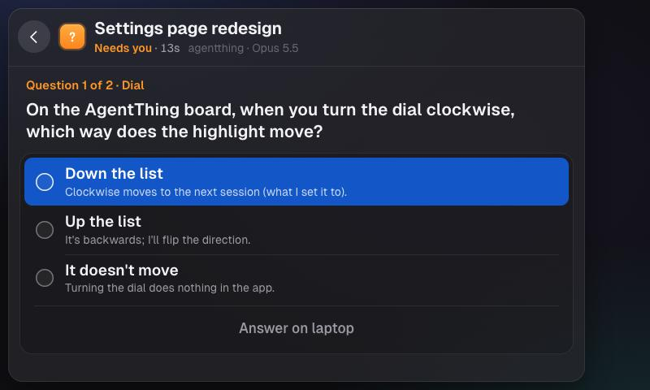
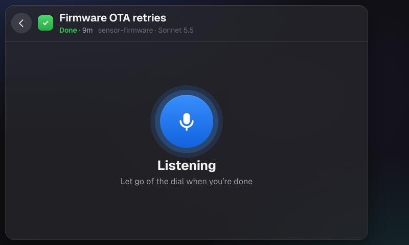
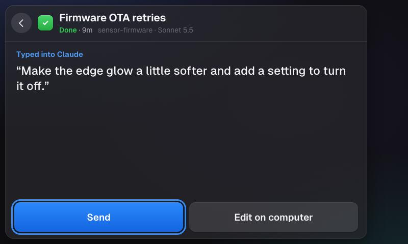

# AgentThing

A desk status board and controller for your Claude Code sessions and Codex threads (in the ChatGPT app), on a Spotify Car Thing running [DeskThing](https://github.com/ItsRiprod/DeskThing).

See what's running and what needs you at a glance. Turn the dial to pick a session, approve or deny Claude's permission requests and answer its questions from the dial, bring a session up on your Mac when you want the detail, and hold the dial to dictate a prompt.



> AgentThing is an independent project. It is not made by, affiliated with, or endorsed by Anthropic or OpenAI.

**Set it up:** follow [docs/SETUP.md](docs/SETUP.md). It takes about five minutes.

## What it does

**Board.** One row per Claude Code session, sorted by what needs you: requests first, then finished, then running. Each row shows the session's title (the same one as Claude Desktop's sidebar), its status and for how long, the model, and what it's doing: the tool it's running, the request it's waiting on, or the first line of Claude's last reply. The board never jumps you to another session; a new request just shows up at the top.

**Permission requests and questions, from the dial.** When Claude asks for permission or asks you a question and the Car Thing is connected, it waits on the Car Thing (2 minutes by default). Approve, Deny, or answer by turning and pressing the dial. **On laptop** hands it to Claude on your Mac instead. If the Car Thing is unplugged or AgentThing isn't open on it, everything goes straight to the laptop as usual.

| Permission request | Question |
| --- | --- |
|  |  |

**Focus.** Opening a session on the Car Thing doesn't touch your laptop. Press **Focus** to bring that exact session up in Claude Desktop.

**Hold to talk.** Hold the dial on a session and speak; let go when you're done. AgentThing brings the session up and holds your dictation app's push-to-talk key (Rhino, Wispr Flow, Superwhisper, or any app with one), so your words are typed into Claude's prompt box as your own. The Car Thing shows what was typed: **Send** it, or **Edit on computer** to fix it first.

| Listening | What was typed |
| --- | --- |
|  |  |

**Codex threads too.** Codex threads from the ChatGPT Mac app (and the Codex CLI) show up on the same board, labelled *Codex*. You can approve or deny their requests from the dial, answer Codex's questions by picking an option (your pick is sent to the thread as your reply), Focus opens the thread in ChatGPT, and hold to talk works the same way. Plain ChatGPT chats aren't shown; the app gives nothing outside it a way to see their status.

**Edge glow.** The screen edges light up for a few seconds when something changes: amber when a session needs you, green when one finishes.

## Requirements

- A Spotify Car Thing with DeskThing on it, and the DeskThing app on a Mac.
- Claude Code. Everything works with the Claude Desktop app; with the Claude Code CLI you get the board, approvals and questions, but not Focus or Desktop's session titles.
- Optional: Codex, in the ChatGPT Mac app or the Codex CLI.
- For hold to talk: a dictation app with a push-to-talk key, and macOS Accessibility permission for DeskThing.

Mac only: it uses macOS tools (`osascript`, `lsappinfo`, `open`) to talk to Claude Desktop and to press keys.

## Controls

| Car Thing | On the board | On a session |
| --- | --- | --- |
| Turn the dial | move between sessions | move between buttons or answers |
| Press the dial | open the session | press the selected button or answer |
| Hold the dial | talk to that session | talk to this session |
| Back button | — | previous question, else back to the board |
| Touch | tap a row | tap a button |
| Top buttons, M | left to DeskThing (switching apps) | same |

A session ignores dial presses for 0.7 s after it opens or its choices change, so a quick double press can't approve or answer something you haven't read.

## Settings

In the DeskThing app on your Mac, under AgentThing's settings:

| Setting | Default | What it does |
| --- | --- | --- |
| Install Claude Code hooks | off | Adds AgentThing's hooks to `~/.claude/settings.json` (backed up first); turning it off removes them. See [setup](docs/SETUP.md#2-connect-claude-code). |
| Install Codex hooks (ChatGPT app) | off | Adds AgentThing's hooks to `~/.codex/hooks.json` (backed up first); then trust them in ChatGPT → Settings → Hooks. Turning it off removes them. |
| Dictation app | Rhino | Which app hold to talk drives: Rhino, Wispr Flow, Superwhisper, another app, or off. Picking one fills in its usual key. |
| Dictation key | right cmd | That app's push-to-talk key, e.g. `right cmd`, `fn`, `option+space`, `ctrl+shift+d`. |
| Wait on the Car Thing | 120 s | How long a request or question waits on the Car Thing before going to the laptop (at most 140). |
| Send to the laptop when you're looking at that session there | off | When on, a session that's in front in Claude on the laptop gets its prompts there instead. |
| Hook server port | 8765 | Where the hooks send events. If you change it with the hooks setting on, the hooks are updated to match. |

## Privacy

Everything stays on your Mac and Car Thing. Claude Code's and Codex's hooks send session events (prompts, tool names and inputs, Claude's last reply) to a server on `127.0.0.1` inside DeskThing, which keeps them in memory only. AgentThing reads Claude Desktop's session list for titles, and, for hold to talk only, the clipboard for a few seconds after you let go of the dial (dictation apps paste through it) so it can show you what was typed. Nothing is logged or sent anywhere else.

## How it works

```
Claude Code (Desktop or CLI)        DeskThing (Mac)                       Car Thing
 hooks ──curl POST──────────▶  AgentThing server  ──────────────────▶  board / session UI
         ◀── allow / deny ───  holds permission requests  ◀───────────  dial + back
                               ├─ claude://code/continue → open a session in Claude Desktop
                               ├─ reads Claude Desktop's session list (titles, archived)
                               └─ holds the dictation key, presses Return (hold to talk)
```

- `server/hookServer.ts`: the HTTP endpoint the hooks post to; holds `PermissionRequest`s and answers them (`allow` with `updatedInput`, `deny`, or nothing to show the laptop prompt).
- `server/sessions.ts`: the session list and which hook moves a session to which state.
- `server/agentHooks.ts`: installs and removes the hooks in `~/.claude/settings.json` and `~/.codex/hooks.json`.
- `server/codex.ts`: reads Codex thread titles, models and archive state from `~/.codex/state_5.sqlite`, and the question a turn ended with from its transcript (read-only; neither is a documented API, so titles fall back to your first prompt). Answers go back with the `codex queue` command bundled in the ChatGPT app plus its `codex://threads/wake/<id>` link.
- `server/desktop.ts`: reads Claude Desktop's session files (`~/Library/Application Support/Claude/claude-code-sessions/…/local_<id>.json`) for titles, archive state and the id the focus link needs.
- `server/mac.ts`: focus via `claude://code/continue?session=local_<id>` (Claude Desktop) and `codex://threads/<id>` (ChatGPT), and "which app is in front" via `lsappinfo`.
- `server/dictation.ts`, `server/keys.ts`, `server/voice.ts`: hold to talk. Key combos are parsed from the setting and pressed with JavaScript for Automation + CoreGraphics.
- `server/text.ts`: turns prompts and Claude's markdown into plain text for the screen.
- `shared/`: types shared by server and device, and the app version (the Car Thing reloads itself when it changes).
- `src/`: the Car Thing UI (React, plain CSS). The device runs an old Chromium: no flex `gap`, `inset`, `clamp()` or `backdrop-filter`.

Focus and Desktop titles rely on Claude Desktop's `claude://` link and session files, which aren't a documented API and could change with a Desktop update. AgentThing falls back to bringing Claude forward and to titles from your first prompt.

### Status rules

| Hook | Effect |
| --- | --- |
| `SessionStart` | row appears as Done |
| `UserPromptSubmit` | Running; the first prompt is the title until Desktop's title is known |
| `PreToolUse` | Running; shows the tool ("Bash: npm test", "Edit: …/src/ota.ts") |
| `PermissionRequest` | Needs you; waits on the Car Thing (questions and plan approvals too) |
| `Notification` `permission_prompt` / `idle_prompt` | Needs you / Done |
| `Stop` | Done; keeps Claude's reply as plain text |
| `SessionEnd` | Ended; the row drops after a few seconds |

Sessions archived or deleted in Claude Desktop drop off the board.

## Development

```sh
npm install
npm run typecheck
npm run build          # → dist/agentthing-v<version>.zip and dist/latest.json
npm run dev:vite       # then open http://localhost:5173/?mock: the UI with sample sessions at 800×480
npm run standalone     # just the hook server in a terminal, printing the board
npm run simulate       # in another terminal: fake sessions and a permission request
```

In `?mock`, the arrow keys or a scroll wheel stand in for the dial, Enter for the dial press (hold it to try hold to talk), and Escape for back. In the standalone console, `a 1` / `d 1` / `f 1` / `l 1` approve, deny, focus, or hand row 1 to the laptop. `GET http://127.0.0.1:8765/state` dumps the board as JSON.

The first 20 key and dial events after the app opens are logged in DeskThing's log (`input key code=…`, `input wheel dx=…`), to check what a unit sends. The Car Thing's dial sends sideways scroll (`deltaX` ±53 per click).

Publishing a release: [docs/RELEASING.md](docs/RELEASING.md).

## License

MIT; see [LICENSE](LICENSE). The bundled Geist fonts are under the SIL Open Font License ([public/Geist-OFL.txt](public/Geist-OFL.txt)).
